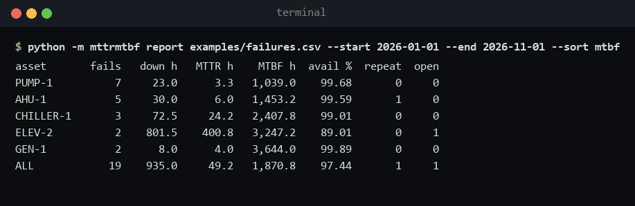

<p align="center"></p>

# mttr-mtbf-calculator

[](https://github.com/yassine2med/mttr-mtbf-calculator/actions/workflows/ci.yml)  

MTTR and MTBF are quoted everywhere in maintenance and almost never calculated the same way twice. Is downtime counted once when two work orders overlap? What happens to a failure that is still open? This repo is a small library and command line tool with one clear set of rules and tests that pin them down.



## What it is for

Reliability engineers, maintenance planners and facility managers who have a failure log (from a CMMS export or a spreadsheet) and want mean time to repair, mean time between failures and availability per asset, for a chosen period. Use it as a command line report, or import `mttrmtbf.core` into your own scripts.

## Install

```
git clone https://github.com/yassine2med/mttr-mtbf-calculator
cd mttr-mtbf-calculator && pip install -r requirements.txt
```

No third-party packages are needed. Python 3.10 or newer.

## How to use

| I want to | Command |
|---|---|
| Report for a period | `PYTHONPATH=src python -m mttrmtbf report examples/failures.csv --start 2026-01-01 --end 2026-11-01` |
| Sort worst first by MTBF (also `mttr`, `failures`, `availability`, `asset`) | add `--sort mtbf` |
| Get CSV or JSON | add `--format csv` or `--format json` |
| Availability from a known MTBF and MTTR | `PYTHONPATH=src python -m mttrmtbf formula 900 100` |

Input CSV columns: `asset_id, failed_at, restored_at, cause`. Times look like `2026-03-02 22:10`. Leave `restored_at` empty for a failure that is still open.

Exit codes: 0 on success, 1 when the report contains a failure that is still open, 2 on a missing file, a bad time, or an invalid window.

Example:

```
PYTHONPATH=src python -m mttrmtbf report examples/failures.csv --start 2026-01-01 --end 2026-11-01
```

Output:

```
asset       fails   down h   MTTR h    MTBF h  avail %  repeat  open
AHU-1           5     30.0      6.0   1,453.2    99.59       1     0
CHILLER-1       3     72.5     24.2   2,407.8    99.01       0     0
ELEV-2          2    801.5    400.8   3,247.2    89.01       0     1
GEN-1           2      8.0      4.0   3,644.0    99.89       0     0
PUMP-1          7     23.0      3.3   1,039.0    99.68       0     0
ALL            19    935.0     49.2   1,870.8    97.44       1     1
```

Library use:

```python
from mttrmtbf.core import load_failures, compute, parse_time

metrics = compute(load_failures("examples/failures.csv"), parse_time("2026-01-01"), parse_time("2026-11-01"))
print(metrics["PUMP-1"].mtbf_hours)
```

This prints `1039.0` (run it with `PYTHONPATH=src`).

Run the tests with `python -m pytest -q`.

## How it works

The rules, all covered by tests:

1. Only failures that start inside the window count.
2. Records that overlap or touch are one incident, so a duplicate work order does not double the downtime or the failure count.
3. A failure with no restore time runs to the end of the window and is reported as open. A repair that runs past the end of the window is cut at the end.
4. Downtime is the total length of the incidents. Uptime is the window length minus downtime.
5. MTTR = downtime / failures. MTBF = uptime / failures. Availability = uptime / window.
6. A repeat failure is one that starts within 7 days of the previous one ending on the same asset.
7. The ALL row adds up failures and downtime; its availability is the average of the assets.

## Limits

- Assets are assumed to run for the whole window (24 hours a day). There is no operating schedule or planned downtime.
- MTBF here is uptime per failure, which suits repairable equipment. It is not a statistical life estimate.
- Times are read as they are written, with no time zones.
- A small sample (one or two failures) gives numbers that move a lot; read them with care.

## License

MIT. Yassine Emhamed, 2026.
